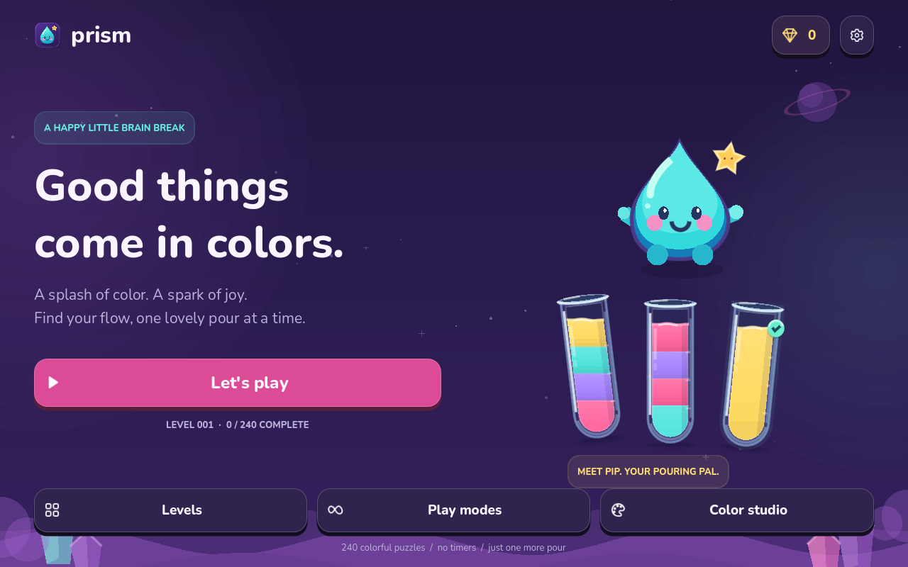
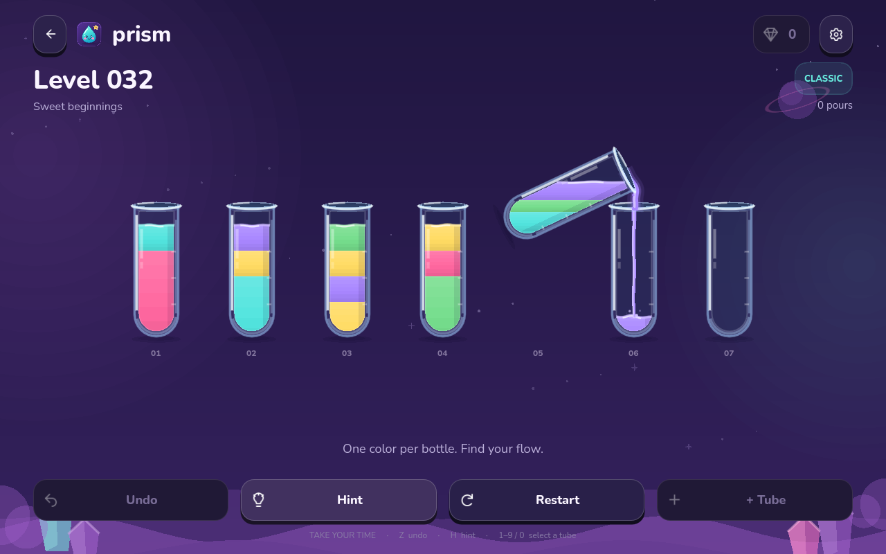

# Prism — Water Sort

A cheerful, offline color-sorting game made in **Godot 4.6.3**. Pour candy-bright liquid between little glass bottles, meet Pip the water spirit, and find your way through 240 puzzles at your own pace.





## Download and play

1. Download this repository with **Code → Download ZIP** and extract it, or clone it:

   ```sh
   git clone https://github.com/akhileshedd71-rgb/Water-sort-color-game.git
   cd Water-sort-color-game
   ```

2. Install the standard, non-.NET edition of [Godot 4.6.3](https://godotengine.org/download/archive/4.6.3-stable/).
3. In Godot's Project Manager, choose **Import** and select `project.godot`. Allow the first asset import to finish.
4. Press **F5** to play. Alternatively, open `scenes/main.tscn` and press **F6**.

Everything needed to play is bundled. There are no plugins, package installs, accounts, servers, ads, or purchases. Python is only needed for the level tools and independent tests.

From a terminal with Godot on your `PATH`:

```sh
godot --path . --editor
godot --path .
```

## How to play

Tap or click a bottle, then its destination. Pour into an empty bottle or onto the same top color, provided there is room. Each pour transfers as much of the matching top block as will fit. Finish with every occupied bottle full of one color.

Take your time: there is no timer or move penalty. Undo, hints, and restart are free; each attempt also has one optional extra helper bottle. Hints follow a verified solution when available and otherwise search the current board. A difficult or deadlocked position can require undoing moves or adding the helper.

| Control | Action |
| --- | --- |
| Tap / left click | Select a bottle, then pour; tap the selected bottle again to deselect |
| `1`–`9`, `0` | Select bottles 1–10 |
| `Tab`, then `Enter` / `Space` | Navigate and activate focused controls or bottles |
| `Z` / `U` | Undo |
| `H` | Hint |
| `R` | Open restart confirmation |
| `Esc` | Close a dialog or return to the home screen |

## A little world of color

- **240 campaign levels**, arranged in six chapters of 40, from two-color introductions to ten-color challenges. These are generated puzzles with stored, independently replayed solution certificates; they are not 240 handcrafted designs.
- **Four rule variants:** Classic, Mystery (`mist`, concealed lower colors), Sky high (`tall`, five-layer bottles), and Tight space (`tight`, one spare bottle). The final chapter mixes variants and includes short three-layer puzzles.
- **Daily splash:** a deterministic remix for each UTC date, playable offline. **Endless play:** repeatable remixes of the bundled campaign with shuffled bottles and colors. Individual variant modes are available without campaign unlocking.
- **Color studio:** three scenery themes, three glass shapes, and three liquid palettes. Unlock alternatives with sparkles earned from first campaign and daily completions.
- **Local saves:** campaign progress, an unfinished campaign board and undo history, best move counts, cosmetics, and preferences.
- **Accessibility options:** numbered color labels, optional sound, and Gentle motion with shorter pours, still scenery, and reduced effects. The interface adapts between portrait and wide windows.

The liquid uses stylized, volume-conserving 2D geometry with tilting surfaces, glossy menisci, pouring streams, splash particles, and completion bursts. It is a visual animation system, not a physical fluid simulation.

## Test and export

Run from the repository root:

```sh
godot --headless --path . --editor --import --quit
godot --headless --path . --script tests/test_puzzles.gd
godot --headless --path . --script tests/test_save.gd
godot --headless --path . --script tests/test_game.gd
python3 -m unittest discover -s tests -p 'test_*.py' -v
```

See [Testing](docs/TESTING.md) for coverage and manual checks, and [Design notes](docs/DESIGN.md) for level generation and project structure.

To create a playable build, install matching **4.6.3 export templates** using **Editor → Manage Export Templates**, then use **Project → Export**. Linux, Windows, and Web presets are included with the campaign JSON filter already configured. Create the destination folder under `builds/` before exporting. Desktop exports need no .NET runtime. Web exports must be served over HTTP rather than opened as local files. For Android, add an Android preset and include `*.json` in its non-resource export filter; it additionally needs the SDK/JDK and signing configuration described in [Godot's Android export guide](https://docs.godotengine.org/en/stable/tutorials/export/exporting_for_android.html). Use a debug export for initial device testing.

Android is an intended export target; this repository does not claim a tested native Android release. Test touch input, safe areas, performance, and resume behavior on real devices before publishing.

## Credits and license

Original game code, vector artwork, Pip, and synthesized sound recipes: [MIT License](LICENSE). No artwork or code from the reference game is included. Nunito is bundled under the [SIL Open Font License 1.1](assets/FONT_LICENSE.txt); [font sources](assets/fonts/SOURCE.txt) identify the upstream files.
